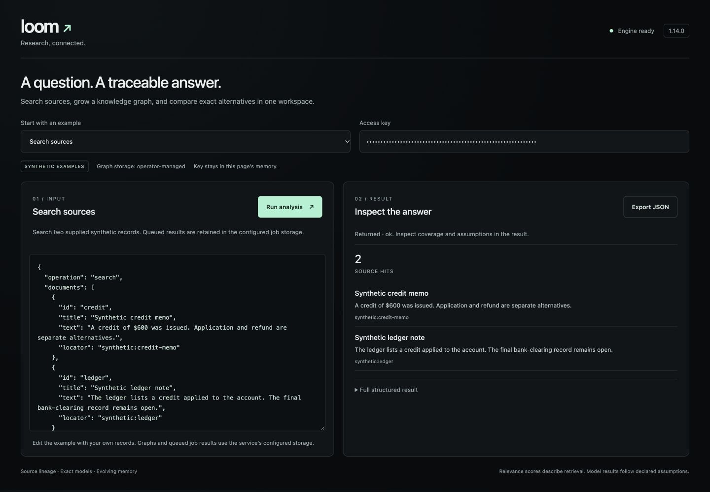

# Loom

AI assistants: start with [AI_GUIDE.md](AI_GUIDE.md) and [AGENTS.md](AGENTS.md). Review [sharing status](docs/SHARING_STATUS.md) before distributing this repository.

Loom is a local-first analytical research engine for building tools that connect records, explain calculations and keep answers traceable as information changes. It brings source retrieval, an evolving knowledge graph, exact conditional models and classical quantum-circuit simulation into one Python runtime.

This private repository contains **Loom 1.19.1**, a browser workbench, authenticated HTTP API, persistent graph storage, CLI, documentation, synthetic examples and tests. It is intended for developers and analysts working on document research, reconciliation, relationship analysis and questions with several possible explanations.

## Try Loom

Start with [QUICK_START.md](QUICK_START.md). Windows users can double-click `Start-Loom.cmd`. Launchers now verify an authenticated synthetic analysis and copy the local access key to the clipboard for pasting into the workbench.

**Windows PC:** run `Start-Loom.ps1` in PowerShell. **Mac:** run `bash Start-Loom.command` in Terminal. Install and start Docker Desktop first. Both launchers prepare local credentials and open the workbench after checking service health.

See [Run Loom on your computer](docs/TRY_LOOM.md) for Docker setup on Windows, macOS and Linux, persistent storage, access keys and optional dependencies.

## What Loom does

Supply records, questions and any structured modeling rules you want to test. Loom can retrieve matching passages, retain their sources and relationships, check scoped inconsistencies, explore feasible alternatives and rank the additional records that would narrow a question. Each result preserves the relevant inputs, assumptions and coverage state.

| Ability | What it gives you |
|---|---|
| Source retrieval | English word normalization for relevance, literal phrase/identifier constraints, evidence-first graph ranking, reusable indexes, source locators and provenance paths. Externally supplied semantic rankings can be bound to a specific query and graph version. |
| Evolving knowledge graph | Resumable, bounded concept/link growth with pending-work receipts; persistent sources, passages, concepts and candidate relationships; immutable revisions, source-family withdrawal, an event journal and replay verification. Explicit intake and bound CLI searches can grow the graph. |
| Entity resolution | Identifier and multi-field comparisons, conflicting-key checks and reviewed, reversible identity groups that preserve the original records. |
| Time-aware research | Separate event, statement, validity and actor-receipt clocks; historical and actor-specific views; dependent results marked stale when their basis changes. |
| Analytical checks | Scoped claim conflicts, repeated event observations, exact quantity comparisons and caller-declared linear invariants, with open dimensions and coverage gaps retained. |
| Exact alternative modeling | Embedded QULAP models enumerate declared finite possibilities and return metric bounds, feasible examples, counterexamples, constraint conflicts and sensitivity results. |
| Next-record planning | Evaluate record bundles, costs and complementary evidence against the worst remaining uncertainty in the declared model. |
| Measured method evolution | Evaluate retrieval recipes against frozen benchmarks and activate scoped recipes or relation schemas through explicit validation gates. Failed candidates remain held and history is retained. |
| Circuit simulation | Classical simulation of quantum-circuit semantics, exact arithmetic for supported operations and visible floating-point modes for others. |

## What Loom does well

**Keeping research inspectable.** A retrieved passage can retain its source locator, origin family, revision and downstream dependencies. When a source changes or new material changes the analytical basis, prior derived results become stale and remain available for inspection. This is useful when several people need to understand how an answer was reached and whether it still reflects the current records.

**Reasoning precisely inside explicit assumptions.** Exact quantities, units, money stages and finite domains make model results reproducible. QULAP can show the smallest and largest value allowed by a model, examples that attain those values and which assumptions affect the answer. Conclusions stay tied to the declared inputs and rules.

**Finding useful combinations of records.** Some questions require two records together. Loom's bounded bundle planner can detect that complementarity rather than treating every record as an independent next step. Its reported guaranteed gain is conditional on the model and complete traversal within the configured budget.

**Preserving continuity across research passes.** The graph, journal, versioned inputs and retained research receipts let a project accumulate useful structure over time. Unchanged research can reuse its cached result; changed evidence triggers recomputation. Candidate links, reviewed assertions and research outputs keep distinct states.

**Giving developers a compact integration surface.** The CLI, JSON API and browser workbench use the same packaged engine. Core execution uses Python's standard library; NumPy is optional. A developer can start with the examples and integrate individual capabilities through the documented contracts.

## A concrete example

Suppose a **synthetic $600 credit** was issued, but its disposition is unresolved. Under the example's accounting rules, it could have been applied, refunded or left outstanding.

Loom can:

1. Retain the credit memo, related passages and the model's assumptions in a graph.
2. Compile reviewed variables and constraints into a QULAP model and calculate an unresolved-credit range of **0–60,000 cents**.
3. Compare a vendor subledger and a refund/clearing record as next-record candidates. Either record alone leaves a worst-case uncertainty; the two together resolve the example's range.
4. Retain the result and mark its dependencies stale when relevant inputs change.

The workbench's **Research and grow a graph** and **Plan complementary records** examples run this workflow. The corresponding API packets are [research-request.json](examples/research-request.json) and [record-bundles-request.json](examples/record-bundles-request.json).

## How to interpret results

Automatic concept and identity links are candidates with recorded provenance. Semantic assertions and model assumptions come from supplied structure or review. Retrieval scores measure relevance, and exact model bounds describe the possibilities permitted by the declared model. Empirical accuracy and research improvement require an appropriate labeled evaluation cohort; the existing tests cover software behavior, synthetic arithmetic and integration. See [validation notes](docs/VALIDATION.md) for the checks actually performed.

## Run locally

For a developer familiar with Python and local web services, setup is a short manual workflow: download or clone the code, configure an access key and storage directory, then start the server. There is currently no one-click installer.

Python 3.9+ and its standard library are sufficient for core execution. NumPy is optional for accelerated simulation and the separate fuzz oracle. The shell commands and API worker's resource limits target **macOS/Linux**; Windows execution has not been validated.

```sh
git clone https://github.com/bbbr8/loom.git
cd loom
export LOOM_API_KEY="$(python3 -c 'import secrets; print(secrets.token_urlsafe(32))')"
export LOOM_DATA_DIR="$PWD/.loom-data"
export LOOM_STORAGE_MODE="local persistent directory"
python3 -B server.py
```

Open **http://127.0.0.1:10000**. Enter the generated key directly in the browser; it remains in page memory. Retrieve your key from your local terminal environment or password manager. Keep it out of committed files and URLs.

The server defaults to loopback. Set `LOOM_HOST=0.0.0.0` only for an intended network deployment behind HTTPS. `PORT` changes the listening port. Restart the server after changing its environment.

## Included stack

| Layer | Contents |
|---|---|
| Browser | Responsive workbench, editable synthetic examples, source-hit inspection, exact record-bundle comparison, structured results and JSON export. |
| API | `POST /v1/analyze` for short synchronous work; authenticated, idempotent `POST /v1/jobs` plus retained status/results for queued work. Graph snapshots and JSON-LD exports use revision-bound pages. |
| Persistence | Operator-selected SQLite graph directory, journal, revisions, source withdrawal, actor/time views, stale-result propagation and replay verification. |
| Engine | Full validated portable Loom 1.17.0 runtime, embedded QULAP, exact arithmetic, simulation, timeline, search, reasoning and bounded improvement curriculum tooling. |
| Deployment | Standard-library service, Dockerfile, manual Render Blueprint and repeatable validation commands. |



The CLI is the full runtime interface:

```sh
./loom version
./loom graph init --db /absolute/path/to/research.sqlite
./loom research demo --directory /absolute/path/to/new-demo
./loom describe --json
```

See [the scalability changes](runtime/SCALABILITY.md), [the API contract](docs/API.md), [research engine guide](runtime/RESEARCH_ENGINE.md), [runtime reference](runtime/README.md) and [validation notes](docs/VALIDATION.md).

## Storage and access

`POST /v1/analyze` search/reason/posture/quantum and standalone QULAP requests process inline data transiently. The workbench uses durable jobs when storage is configured: queued/running requests and completed results are retained in the operator’s job store. Completed request bodies are removed; result snippets, queries and metadata remain. `LOOM_JOB_DIR` can separate job storage from graphs; otherwise it uses a private `.loom-jobs` subdirectory of `LOOM_DATA_DIR`. Graph and research operations explicitly persist their supplied records, models, results and learning receipts under `LOOM_DATA_DIR`. A graph name selects an isolated file in that directory; clients cannot supply filesystem paths. Request capture into a graph is explicit in this API. Local CLI graph binding is configured separately.

The operator key grants access to every graph. An optional `LOOM_ACCESS_FILE` defines individual hashed tokens with reader/editor/admin roles and explicit graph permissions. Scoped job polling enforces graph access; inline jobs retain their principal scope. This is a single-service project access boundary; direct filesystem access and distributed quotas remain operator concerns. The process does not intentionally log request bodies, retain ordinary request telemetry or train model weights. Infrastructure may retain its own metadata. Persistence and secure erasure depend on the operator's storage and backup configuration.

The API accepts structured JSON rather than arbitrary programs, SQL, source-file paths or local corpus access. Native adapters remain available only in an appropriately configured local CLI environment. Resource bounds: 256 KiB request, 100 inline documents, 64 HTTP connections and 4 MiB result. The synchronous route permits one analysis and 30 attempts/minute with 10 CPU/12 wall seconds. The durable queue accepts 120 submissions/minute, has two workers and 64 pending/running jobs, and uses 120 CPU/125 wall seconds. Busy/full work receives structured 429/503 responses. Queue history is bounded to 512 jobs and 256 MiB of retained payloads; an operator must archive it when full. Linux worker memory bounds are 512 MiB synchronous and 3 GiB queued; macOS uses CPU/wall bounds and bounded input/work limits. A timeout during a graph mutation requires checking the retained graph before retrying.

## Deploy

`Dockerfile` runs as a non-root user. Pass `LOOM_API_KEY` as a runtime secret and mount writable durable storage at `/data` owned by uid 10001. Do not bake keys into images. A container mount is required for retention across container replacement.

`render.yaml` retains manual deployment and free compute. The Blueprint's graph directory is explicitly **ephemeral** and is lost when its instance is replaced. Configure durable storage on a suitable service before using hosted graph retention for important records. The GitHub App must have access to this private repository. This source update does not claim a running Render deployment.

## Verify

```sh
python3 -B -m unittest discover -s tests -v
python3 -B runtime/tests/test_research.py
python3 -B runtime/tests/test_integrations.py
```

All 196 runtime files are fingerprinted in `SOURCE_MANIFEST.json`. The imported runtime is byte-for-byte identical to the validated Loom 1.17.0 release, including its build manifest. Native case files, local research graphs, credentials, usage databases and machine-specific state are excluded. Ten small runtime SQLite fixtures are explicitly synthetic temporal, ranking and upgrade-compatibility regression cases.

The earlier 1.11.1 API and 1.13.0 full stack remain recoverable in Git history. Existing API requests continue to work. No open-source license grant is made by this private repository.

## Architecture in 1.15

Graph reads pin one revision; stale derived plans stop before committing. A bounded, checksummed read projection accelerates repeated graph queries. The durable queue has exclusive process ownership and schedules unrelated graphs around busy ones. See [architecture, compatibility and operating contracts](docs/ARCHITECTURE_1_15.md).

[Measured 1.15 results and remaining limits](docs/UPGRADE_1_15_RESULTS.md): about 45% lower warm graph-query latency on a matched real-data cohort, preserved rankings, maximum graph verification and queued-burst checks.

## SQLite quick start

```sh
./loom sqlite init --db .loom-data/research.sqlite --demo
./loom sqlite inspect --db .loom-data/research.sqlite --check
./loom graph search --db .loom-data/research.sqlite "release credit"
./loom sqlite backup --db .loom-data/research.sqlite --out .loom-data/new-backup.sqlite
```

Omit `--demo` for an empty production graph. See [SQLite setup, schema and programming interface](runtime/SQLITE_BOOTSTRAP.md). The included starter database contains explicitly synthetic sources and candidate relationships.

## Research Studio in 1.17

Seven connected upgrades add incremental indexed search, an optional offline semantic adapter, source-span relationship proposals and review, document intake, next-record tests, a visual source explorer, and recovery/team controls. Start with [the studio guide](runtime/RESEARCH_STUDIO.md). Optional reader/model dependencies are pinned in `requirements-intake.txt` and `requirements-semantic.txt`; the default server remains standard-library only.

The browser offers question controls for a named imported graph, explanation cards, source/relationship/revision inspection and record tests with supporting and weakening outcomes. `loom studio` provides the same local workflow plus explicit document paths and offline model indexing. See [measured results and practical limits](docs/UPGRADE_1_17_RESULTS.md).

The existing dynamic ontology upgrade is preserved: inherited type contracts, nested field validation, bounded rule expansion and versioned schema comparison remain available through `loom ontology`. It validates declared shapes and preserves native payloads.

## Case reasoning and explanation (1.18)

Source-span adapters, versioned findings, actor-specific knowledge states, money lifecycles, aligned statement comparisons, sourced episode drafts, reviewed OCR and frozen case evaluations are available through the language, CLI and API. See [Case workbench](runtime/CASE_WORKBENCH.md). Private case records and pilot outputs are retained outside this repository.

## Typed normalization (1.19)

Original values, rules and ambiguity accompany normalized names, dates, identifiers, exact amounts and document fields. Derived views retain source dependencies; normalized-form retrieval is opt-in. See [Normalization](runtime/NORMALIZATION.md).

Larger native-data reliability fixes and validation: [Loom 1.19.1](docs/UPGRADE-1.19.1.md).
