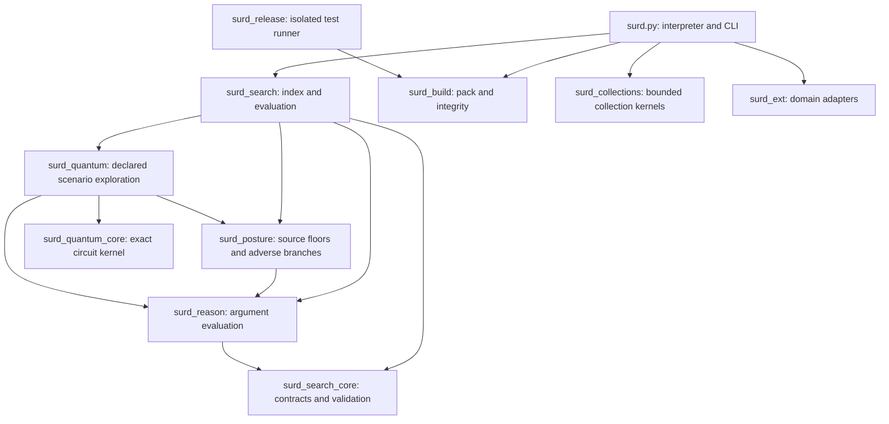

# Loom architecture and reproducible builds

From 1.13, `loom_research` is the persistent analytical research subsystem.
`contracts` defines bounded, exact source/graph inputs; `store` implements journaled
SQLite projections, historical views and dependency invalidation. `retrieval`,
`identity`, `analytics`, `compiler`, `planner` and `learning` implement distinct
analytical operations. `engine` composes them; `cli` and `surd_integrations` expose
the same operations to commands and Loom programs. Optional `capture` binds normal
source searches to an explicitly selected local graph. See [RESEARCH_ENGINE.md](RESEARCH_ENGINE.md).
Mutable graph/configuration state stays outside portable release allowlists.

The interpreter remains the composition root. Its numerical core still lives in `surd.py`; this change isolates search/reasoning contracts and build tooling without changing stored-index schemas or quantum evaluation semantics.

`surd_search_core.py` is a standard-library leaf. It owns shared errors, canonical serialization, tokenization, option/scope validation and the `ReasoningCorpus` protocol. Reasoning may depend only on that leaf, and consumes `search`, `document`, `documents`, `document_tokens`, `in_scope` and `manifest`. SearchIndex implements this interface and returns independent document snapshots and immutable token tuples. It retains its original private storage, ranking and hash formats. Python's runtime protocol check verifies member availability; adapter semantics must still be tested. The boundary tests exercise a public-only adapter.

`surd_collections.py` is another standard-library leaf. It consumes injected callback, typed-scalar-key, truth and checkpoint functions; it never imports the interpreter. Loom adapts exact language values at the composition root. From 1.10, quick/release validation includes collection regressions and an independent exact-rational pipeline oracle.

`loom-lang build check` parses imports throughout root Loom modules, rejects missing local imports and dependency cycles, enforces the reasoning/core/collections import boundaries, and rejects direct `index._private` access in reasoning. This is a focused static check, not whole-program verification; dynamic imports and aliased private access are outside its scope.

`surd.build.json` explicitly lists portable inputs. Builds exclude native case stores, mutable state, training runs, logs and machine-specific build metadata. Existing case-oriented adapter source and case-derived illustrative example comments remain included; this is a private portable runtime package, not a redacted public distribution. Source bytes are captured, hashed and checked again before atomic publication. The embedded `BUILD_MANIFEST.json` records every included file, its size, normalized permissions, version and module graph. SHA-256 manifests detect drift and corruption; they are not authenticated signatures.

Archives use sorted USTAR members, normalized ownership and permissions, and a stable gzip header. Identical source inputs, Python/zlib toolchain and `SOURCE_DATE_EPOCH` produce identical bytes regardless of output filename. The default epoch is zero; an explicit epoch must be in 0..4294967295. Byte reproducibility across different compression implementations is not promised. See the [SOURCE_DATE_EPOCH convention](https://reproducible-builds.org/docs/source-date-epoch/).

Extraction validates all members before writing: one versioned root, relative canonical paths, regular files only, no links or duplicate members, at most 513 files and 32 MiB uncompressed. It verifies hashes and permissions before publishing a new destination. Release verification checks integrity again after execution and records the archive and manifest hashes with host, interpreter, duration, subprocess exits and captured output.

| Profile | Required coverage |
| --- | --- |
| quick | Architecture/build, search, reasoning, assumption-path, upgrade, runtime, posture, improvement, collection and quantum regressions; builtin documentation; 100 DAGs, 100 posture graphs, 100 collection cases, 50 independent circuit cases; every packaged example with seed 1 |
| release | Quick coverage with 2,500 DAGs, 1,500 posture graphs, 2,500 collection cases, 1,000 independent circuit cases; every example with seeds 1/2/3; selftests with and without NumPy |
| fuzz | Independent NumPy simulator comparisons and invalid-input fuzzing |

Any required failed or skipped check fails the profile. JSON checks require literal `ok: true`. Builtin documentation requires every portable example to verify. The three native-store examples (`docs`, `anchor_check`, `stages`) report `verified: null` and `integration_required`; they are listed separately and never counted as verified. Use `loom-lang describe --json --integrations` to execute those examples against configured native stores. The portable fuzz profile deliberately excludes the optional external `numeric_spine/quantum_logic.py` oracle (30 checks); that exclusion is reported explicitly. Native-case tests, training/held-out runs and language-suite contract validation remain separate integration work and are not represented as portable release passes. Successful synthetic argument evaluation does not establish natural-language entailment or a case conclusion.

`gate.sh` retains the existing workspace integration gate. The portable `loom-lang build verify` route operates on an immutable archive and avoids training/history writes. New adapters should implement the public corpus interface, carry the existing source fingerprints, and add semantic contract tests before being used by reasoning.

`surd_quantum_core.py` is a standard-library leaf implementing exact phase-oracle, diffusion and Walsh circuits. `surd_quantum.py` composes it with public reasoning/posture contracts and source metadata guards; `surd_search.quantum` supplies CLI/persistence integration. No import from the interpreter core is required. See [QUANTUM_REASONING.md](QUANTUM_REASONING.md).
